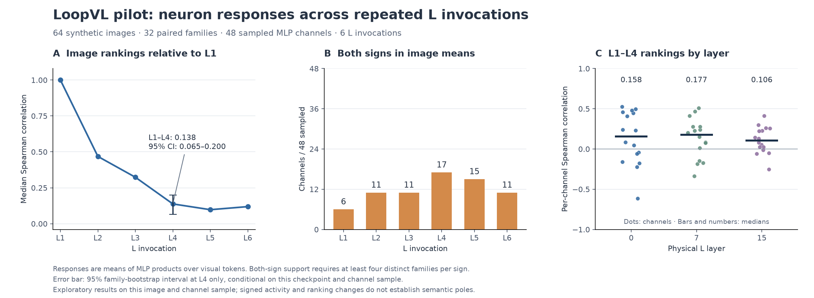
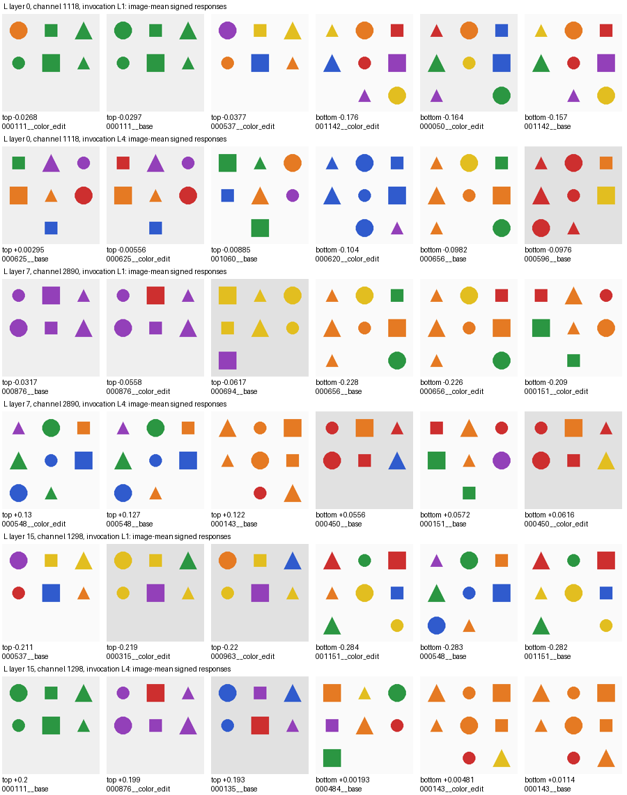

# LoopVL signed responses across loop invocations

October 17, 2026. **Completed and verified.** GPU job `7517236` collected the experiment; CPU job `7517514` verified the saved captures and recomputed the statistics.

The sampled channels showed weak preservation of image-response rankings between L1 and L4: median Spearman correlation **0.138**, with a whole-family bootstrap 95% interval of **[0.065, 0.200]**. Signed image responses also changed across invocations. This is evidence about activation responses on this sample; it does not establish changing semantic concepts or reproduce the paper's semantic poles.

## What was measured

One observational experiment used the existing frozen LoopVL checkpoint in evaluation mode:

- 64 controlled images: base and color-edit versions of 32 pilot scene families, selected before capture.
- 48 presampled physical MLP channels: 16 each from L layers 0, 7, and 15.
- All six L invocations, preserving physical parameter identity within the recurrent execution.
- Actual gate preactivations, effective gates, value branches, and products entering `down_proj`, at all 256 visual tokens on each image's 16 × 16 grid.
- Fixed prompt: `Describe the image briefly.` Eight base images were repeated with `Briefly describe the picture.`
- 73 model forwards: 64 primary, eight paraphrase controls, and one independent official validation forward.

The primary response is the unweighted mean product over visual tokens. Spatial minima and maxima are separate measurements. Both-sign coverage requires responses above +1e-6 on at least four distinct families and below −1e-6 on at least four distinct families. Edited siblings remain grouped in the 500-draw bootstrap.

The [configuration](../../configs/poles-pilot.yaml) freezes the channels, families, image hashes, prompts, and random seed 20261017. Only the existing pilot split was used.

## Results



[Open the chart at full size](results_overview.png) · [Download the vector version](results_overview.svg)

Panel A compares image-response rankings at each invocation with L1; the confidence interval applies only to L4. Panel B counts channels with supported image-mean responses of both signs. Panel C shows every sampled channel's L1/L4 correlation, grouped by physical layer, with the median marked. These are activity measurements, not semantic labels.

| L invocation | Median per-channel image-ranking correlation with L1 | Channels with both signed image means |
| --- | ---: | ---: |
| L1 | 1.000 | 6 / 48 |
| L2 | 0.468 | 11 / 48 |
| L3 | 0.323 | 11 / 48 |
| L4 | 0.138 | 17 / 48 |
| L5 | 0.098 | 15 / 48 |
| L6 | 0.119 | 11 / 48 |

All 48 channels had both positive and negative spatial responses at every invocation under the same family-support rule. Opposite signs at different spatial locations are a weaker finding than opposite image-mean responses. Neither criterion alone establishes interpretable semantic poles.

| Physical L layer | Channels | Median L1/L4 correlation | Both signed image means at L1 | At L4 |
| --- | ---: | ---: | ---: | ---: |
| 0 | 16 | 0.158 | 1 / 16 | 8 / 16 |
| 7 | 16 | 0.177 | 3 / 16 | 7 / 16 |
| 15 | 16 | 0.106 | 2 / 16 | 2 / 16 |

All 48 L1/L4 correlations were defined; no constant channel was assigned an artificial zero correlation. Individual correlations varied, and two of the 48 channels had correlations at least 0.5. The low median therefore does not describe every channel equally.

For paired color edits, the median per-channel agreement in response direction between L1 and L4 was **52.4%**. Each channel had 31–32 eligible families out of 32. Pooling eligible family/channel comparisons gives **775 / 1,535 = 50.5%**, with 1,535 of 1,536 comparisons eligible. These are different aggregations of the same observations, not independent results or a formal test against chance. Median absolute edit effects were 0.00568 at L1 and 0.00992 at L4 in product-activation units. Positive and negative edit effects were approximately balanced in the pooled sample.

The paraphrase control changed image responses: median absolute change was **0.167 image standard deviations**, normalized per channel and invocation over the primary images. This is a small eight-image control and does not establish prompt robustness. The unnormalized median absolute change was 0.00342; the maximum was 1.260, so effects were heterogeneous.

Positive products often came from two negative branches. Among sampled channels, the median fraction of positive spatial products supplied by a negative effective gate and negative value was **76.2% at L1** and **82.5% at L4**. Product sign alone therefore does not identify a gate's semantic polarity.

The [signed-tail gallery](signed_tail_gallery.png) shows three channels chosen before capture, one per physical layer, at L1 and L4. It displays the highest and lowest image-mean responses, which need not have opposite signs. No semantic labels were assigned from these examples.



## Validation and implementation

The first image passed all 54 selected-product, full-product, and full-projection reconstruction checks across the three layers and six L invocations with maximum absolute error **0**. Official first-prediction logits also agreed exactly with the instrumented forward. Selected branch/product consistency, recurrent event counts, and physical parameter identity were checked during every captured forward; full projection and official-logit comparisons were limited to the first image.

Offline verification checked all **72 capture archives** against their saved hashes, shapes, finite values, and event counts. Image means, extrema, sign counts, and paraphrase means reproduced exactly from the raw captures. Every primary statistic, including the family bootstrap and per-neuron rows, then reproduced exactly. See [verification](verification.json).

Verification exposed a serialization issue: canonical JSON sorts layer-map keys as `0, 15, 7`, while the tensor axis follows capture order `0, 7, 15`. The source verifier now restores and validates the explicitly recorded layer list and channel axis. A regression test covers the JSON round trip and rejects an inconsistent axis. The frozen collector and original measurement files were preserved; raw-to-pooled verification independently checked the correct mapping. The three focused rank/serialization tests passed in the CPU job; the earlier 35 engineering tests remain recorded in the [execution history](EXECUTION_HISTORY.md).

## Resources and reproducibility

- GPU: one RTX A6000 on `gpu1503`; Slurm state `COMPLETED`, 213 allocated seconds, **0.0592 GPU hours**. Measured collector runtime including loading/audit was 190.9 seconds.
- Peak allocated Torch GPU memory: **3.10 GiB**. Compressed capture archives: **37.9 MiB**.
- Shared budget after accounting: 0.1406 of 30 GPU hours consumed across all recorded jobs; no outstanding reservation.
- Collector snapshot: `../../../experiments/loopvl-poles-pilot-20261017/snapshot/`, SHA256 `94b282380e13efc499c530256a9276632732c206826511d970e6d09ffd55584d`.
- Configuration SHA256: `e6d3cff8917994f74d2598231d21183345c7bcc2efd6df30cb7e99ef2bbd4562`.
- Offline verifier and tests: `../../../experiments/loopvl-poles-pilot-20261017/analysis-v1/`; its manifest and checksums pin the analysis code.
- Before execution, the version-pinned local project package was restored to match the frozen dependency list. Torch and all other dependency versions already matched; the saved cluster repair record at `experiments/loopvl-poles-pilot-20261017/environment-repair.json` records the offline wheel and before/after lists.
- [Execution metadata](execution.json), [GPU log](gpu-7517236.log), and [CPU verification log](verification-7517514.log).

Machine-readable results are in [summary.json](summary.json), [per_neuron.csv](per_neuron.csv), and [descriptive_context.json](descriptive_context.json). The run directory also retains raw branch captures, pooled measurements, the exact protocol, and image metadata. Recompute primary statistics from this checkout without loading a model:

```bash
PYTHONPATH=src python -m reuseinterp.poles --run-dir results/poles-pilot-20261017
```

Full raw-capture verification additionally requires the activation archives retained on the cluster and the pinned CPU batch script in `experiments/loopvl-poles-pilot-20261017/analysis-v1/verify.sbatch`. The committed bundle includes pooled measurements and image metadata; raw activation archives remain on the cluster.

## What the result supports

The measured image-response rankings vary substantially across loop invocations on these scenes. Both-sign image-mean coverage also varies nonmonotonically. The bootstrap interval describes uncertainty over these 32 scene families conditional on this checkpoint and these 48 channels; it is not uncertainty across architectures, training seeds, or the full neuron population.

Spatial averaging can conceal cancellation and relocation, and BF16 quantization can affect ties. Changes in response ranking therefore do not by themselves establish changes in a neuron's semantic role. This pilot has no task-accuracy, semantic-coherence, or causal intervention endpoint. It does not establish semantic poles, superposition, memorization, circuits, or an architectural difference from ordinary transformers. It is a completed exploratory LoopVL experiment on synthetic images; the image-model reproduction and training experiments in the plan remain to be done. Original population-study gates were not changed.
